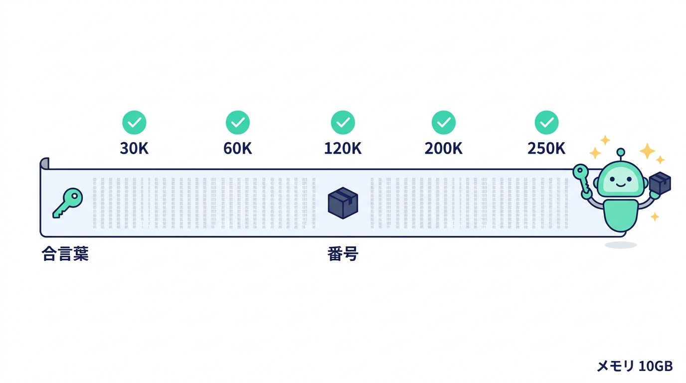
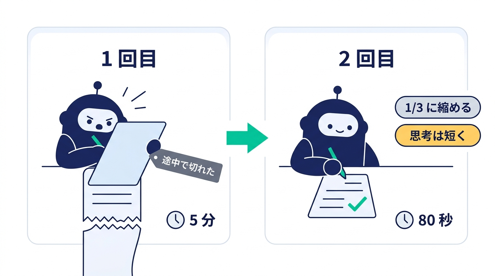
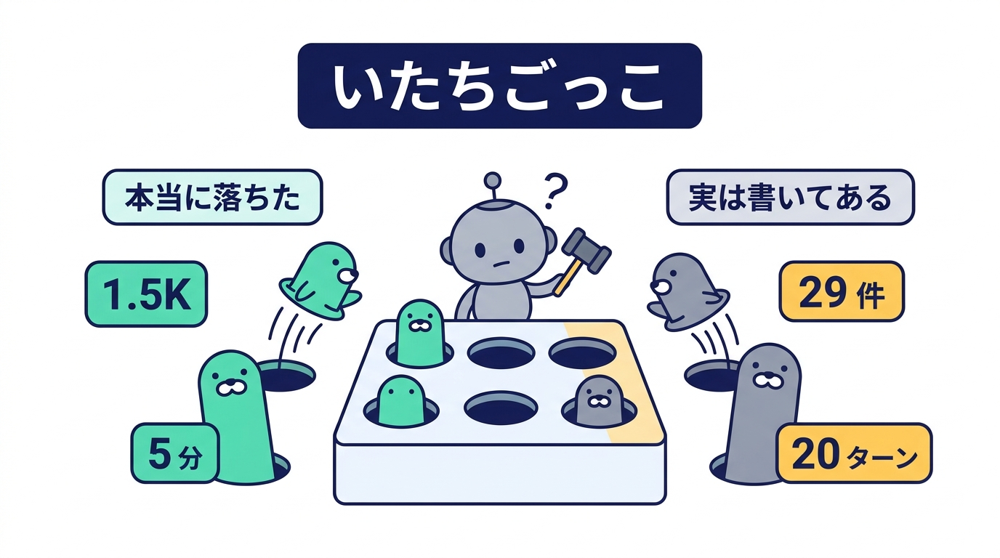
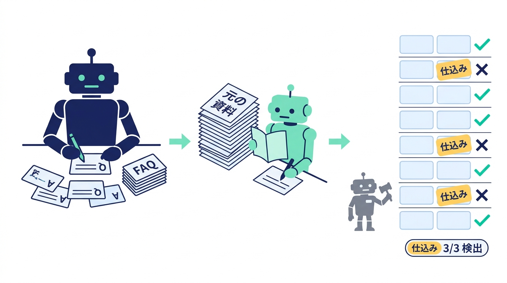
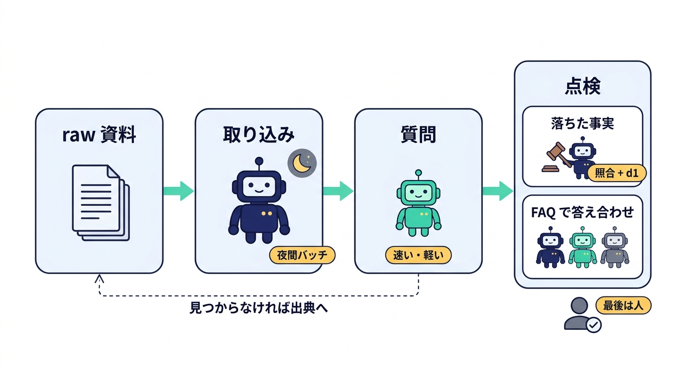

<!--
🎨 図の生成ガイド（この記事の図はすべて個別に画像生成する。各図の直前にある「🎨 FIG-NN」コメントのプロンプトを使う）

■ 全図共通のスタイル（各図のプロンプトの先頭にこの STYLE を付けて生成する）
STYLE: Flat vector infographic for a friendly Japanese tech blog. White background, generous whitespace,
rounded rectangles and circles, thin clean outlines, no gradients, no 3D, no photorealism, no drop-shadow clutter.
Palette: deep navy #1E2761 (main shapes, headings), mint green #02C39A (accents, arrows, highlights),
pale blue #EFF4FD (cards), soft gray #5A6478 (secondary text), small touches of warm yellow #FFD166 for sparkles only.
Mood: pop and cheerful but tidy. Small cute robot characters (round head, antenna, simple face) may appear as mascots:
a BIG robot (Strata), a SMALL robot (LFM3) and a tiny robot holding a judge's gavel (d1).
Render every Japanese label EXACTLY as quoted, in a clean sans-serif (Noto Sans JP style),
keep labels short, and do not add any other text. Default aspect ratio 16:9 (1600x900) unless noted.

■ 出力先: images/blog-llm-wiki/figNN-*.jpg（記事中の画像リンクと同じファイル名）
■ 図の一覧: 01 3 体のロボットと Wiki / 02 長文の拾い出し / 03 取り込みの失敗と修正 / 04 Wiki と元の資料の比較 /
  05 点検のいたちごっこ / 06 工程ごとの分担 / 07 FAQ で答え合わせ
-->

# 🏠 ローカル LLM だけで「LLM Wiki」をやってみた。書くのは 125B、読むのは 1.7B、見張るのは判定専用モデル

こんにちは！2026 年 4 月に Andrej Karpathy さんが公開した「**LLM Wiki**」、覚えていますか？ 資料を毎回検索する代わりに、LLM が資料を読んで Markdown の Wiki を書き、育て続けてくれる、というアイデアです。

> Obsidian is the IDE; the LLM is the programmer; the wiki is the codebase.

読んだときは「いいなあ」と思いつつ、正直こうも思っていました。**これをローカル LLM でやるのは、まだ現実的じゃないよね** 😅 強いクラウドのモデルに資料を何十本も読ませて、ずっと Wiki を書き直させる……となると、気になるのはお財布です。

ところが最近、手元の Mac（M4 Max・メモリ 128GB）で動くモデルの顔ぶれがずいぶん変わりました。そこで、**全部ローカル・料金ゼロで LLM Wiki を回せるのか**、1 日かけて試してみました。うまくいったことも、いかなかったことも、数字つきでお届けします 🙌

`125B と 1.7B` / `256K 文脈` / `判定専用モデル` / `Wiki の取り込み・質問・点検` / `失敗談多め`

<!-- 🎨 FIG-01 | file: images/blog-llm-wiki/fig01-overview.jpg | 16:9
PROMPT: Three robot mascots standing around a large open notebook labeled "Wiki" in the center.
Left: a BIG navy robot holding a pen, badge "Strata 125B", caption below "書く".
Right: a SMALL mint robot reading the notebook with a magnifying glass, badge "LFM3 1.7B", caption below "読む".
Front: a tiny gray robot holding a judge's gavel, badge "d1", caption below "見張る".
Behind them, a laptop silhouette with a small house icon on its screen and a tag "料金ゼロ". A few yellow sparkles.
-->

## 🧭 この記事でわかること

1. 🤖 **今回の 3 体**（125B の Strata、1.7B の LFM3、判定専用の d1）
2. 📏 **1.7B のモデルは長い資料をどこまで読めるか**（256K まで試しました）
3. ✍️ **Wiki を作る**（取り込み）
4. 📖 **Wiki を読んで答える**（質問）—— 丸ごと読ませるのをやめて、索引から探させる形に直しました
5. 🕵️ **Wiki を見張る その 1：落ちた事実を探す** —— いちばんの失敗談です
6. ✅ **Wiki を見張る その 2：書いてあることを FAQ で答え合わせ** —— 最後の逆転劇です
7. 🧩 **結局どう分担するのがよさそうか**

## 🤖 今回の 3 体

| | Strata（Qwen3.8-Flash-Next 125B、IQ3_S） | LFM3-1.7B | d1-2B |
|---|---|---|---|
| 役割 | 書く | 読む | 見張る |
| メモリ | 約 66GB（256K 文脈） | 約 5〜10GB（256K 文脈） | 約 2GB |
| 速さ | 生成 50〜65 トークン/秒、読み込み 450〜550 トークン/秒 | 生成 170〜180 トークン/秒 | 判定 1 件 0.05 秒 |
| 動かし方 | Strata（専用の推論エンジン） | LM Studio | llama.cpp（`/v1/systemone`） |

**Strata** は、125B の MoE モデルを Mac で動かす専用エンジンです。賢いぶん、どうしても遅めです。

**LFM3** は、Liquid AI が 2026 年 10 月 27 日に出したばかりの約 2B のモデル群です。テキスト版の LFM3-1.7B は、なんと **256K 文脈**に対応しています。

**d1** は、同じ LFM3 から作られた**判定専用のモデル**です。文章を生成せず、「はい／いいえ」「選択肢から 1 つ」「段階評価」を、確率付きで一度の計算で返します。試しに「今月 2 回請求されています。1 回分を返金してください。」を渡すと、返金の要求か = 0.99、担当は請求チーム = 0.98 と即答でした ⚡

## 📏 1.7B は長い資料をどこまで読めるか

まずは LFM3 の基礎体力から。意味のない単語をずらっと並べた長文の**冒頭に合言葉**、**真ん中に番号**を埋めて、最後に両方を聞き出します。

<!-- 🎨 FIG-02 | file: images/blog-llm-wiki/fig02-needle.jpg | 16:9
PROMPT: A very long horizontal scroll of gray placeholder text stretching across the image. At the far left a small
mint key icon labeled "合言葉", in the middle a small navy box icon labeled "番号". Above the scroll, five mint
checkmarks evenly spaced with labels "30K", "60K", "120K", "200K", "250K". At the right end the SMALL mint robot
holding up the key and the box happily. Small caption at bottom right "メモリ 10GB".
-->

| 長さ | かかった時間 | 冒頭の合言葉 | 真ん中の番号 |
|---|---|---|---|
| 30K | 22 秒 | ✅ | ✅ |
| 60K | 35 秒 | ✅ | ✅ |
| 120K | 1 分半 | ✅ | ✅ |
| 200K | 4 分 | ✅ | ✅ |
| 250K | 6 分 20 秒 | ✅ | ✅ |

全問正解です 🎉 同じ試験で、Strata は 250K に約 10 分かかっていました。メモリは Strata の 66GB に対して、LFM3 は 250K を読んだあとでも約 10GB です。

とはいえ、これは「単語の羅列から目立つ一文を探す」だけの易しい試験です。そこで、実際の資料でも試しました。

- **英語:** Strata のリポジトリのドキュメント 4 本（9.7 万トークン）。事実を聞く 8 問すべて正解、82 秒
- **日本語:** 手元のプロジェクトの資料 5 本（11.4 万字、5.5 万トークン）。8 問中 7 問正解、1 問は惜しい、93 秒

うれしかったのは、**資料に書いていないことを聞くと、ちゃんと「資料に記載なし」と答えた**ことです 👏 一方で、**要約は苦手**でした。要点を外したり、短い要約で思考が止まらなくなったり。この「事実の抜き出しは得意、まとめるのは苦手」という性格が、このあと何度も効いてきます。

## ✍️ Wiki を作る（取り込み）

ここからが本番です。日本語の資料 5 本を `raw/` に置き、Strata に 1 本ずつ「この資料の Wiki ページを書いて」と頼みます。最後に索引ページ `index.md` も書いてもらいます。Karpathy さんの案ではエージェントが自分でファイルを読み書きしますが、今回は簡単にするため、台本が資料を渡して、Strata は文章を書くだけにしました。

……で、**1 回目は失敗しました** 😇

<!-- 🎨 FIG-03 | file: images/blog-llm-wiki/fig03-ingest.jpg | 16:9
PROMPT: Two panels side by side. Left panel titled "1 回目": the BIG navy robot copying a long document word by word
onto a page that runs off the edge and is cut with a jagged tear, a small red-free gray tag "途中で切れた", and a clock
labeled "5 分". Right panel titled "2 回目": the same robot calmly writing a neat, shorter page with a mint checkmark,
tags "1/3 に縮める" and "思考は短く", and a clock labeled "80 秒". A mint arrow from left to right.
-->

「数値や設定値は落とさないで」「要約しすぎないで」と頼んだところ、Strata は**資料をほぼそのまま書き写し始めました**。じっくり考えたうえで書き写すので、1 本に 5 分かかり、出力の上限で途中で切れてしまいます。

そこで、こう直しました。

- 長さは**資料の 3 分の 1 程度**に。言い回しや例・図の説明は削り、事実を残す
- **思考は短く**（Strata の `reasoning_effort: low`）
- 出力の上限を 16,000 から 32,000 トークンに

これで 1 本 80 秒になり、5 本と索引で **9.4 分**。Wiki 全体は 4.6 万字で、元の資料の約 4 割です。あとで確かめる問題の答えになる事実は、**12 個中 11 個が残りました**。落ちたのは「Chrome は 1 ツールあたり 1.5K 字を勧めている」という一文だけです。

失敗してもプロンプトを直して最初からやり直せばいいだけで、**何回やっても料金はゼロ**。ローカルのいちばんのうれしさは、実はここかもしれません 💸

## 📖 Wiki を読んで答える（質問）

できた Wiki を LFM3 に読ませて、さっきの日本語の問題に答えてもらいます。元の資料を直接読ませた場合と比べると……

<!-- 🎨 FIG-04 | file: images/blog-llm-wiki/fig04-query.jpg | 16:9
PROMPT: Two stacks of paper side by side feeding into the SMALL mint robot in the middle. Left stack tall, labeled
"元の資料 5.5 万トークン". Right stack shorter and neatly bound, labeled "Wiki 2.2 万トークン". Above the robot two
score cards: left card "7 問 + △1" and right card "7 問 + ✕1". Over the right card, a small thought bubble where the
robot is gluing a puzzle piece labeled "500 字？" into a gap labeled "1.5K 字". Gentle, slightly humorous.
-->

| | 元の資料を読ませる | Wiki を読ませる |
|---|---|---|
| 渡した量 | 5.5 万トークン | 2.2 万トークン |
| かかった時間 | 118 秒 | 92〜142 秒 |
| 正解数（事実の 8 問） | 7 問 + 1 問は惜しい | 7 問 + 1 問は誤り |
| 答えが出なかった回 | なし | 3 回中 1 回（思考が止まらず上限に） |

なんと、**元の資料のほうが正確**でした 😳

いちばん気になったのは誤りの中身です。Wiki から落ちた「Chrome の 1.5K 字」を聞くと、LFM3 は「記載なし」と言わずに、**近くにあった別の数字（説明文は 500 字以内、など）を組み合わせて答えた**んです。元の資料に答えがないときは正直に「記載なし」と言えていたのに、です。

> 🧩 **取り込みで落ちて、質問で作り話で埋まる**
> Wiki 方式には、この 2 段階の危うさがあります。小さいモデルは「何かそれっぽいものがある」と、そこから答えを組み立ててしまうようです。

それに、渡す量は 4 割になったのに、**速くもなりませんでした**。LFM3 の思考が長くなったためです。11 万字くらいなら LFM3 は全部を一度に読めるので、Wiki を挟む利点がまだ出ない、というのが正直なところです。

いっぽう、良いところもありました。Linux の sandbox の前提を聞く問題では、元の資料からは手順を並べるだけだったのに、**Wiki からは「bubblewrap と user namespace」と要点を答えられた**んです。整理されたページは、要点を問う質問には効いています ✨

### 丸ごと読ませずに、索引から探させる

そもそも LLM Wiki の読み方は、**索引（`index.md`）を見て、リンクをたどり、必要なページだけを読む**はずです。全部を一度に読ませていたのでは、Wiki を作った意味が半分しかありません。

そこで、検索そのものは Python のツールに肩代わりさせることにしました。LFM3 に最初に渡すのは索引だけで、あとは LFM3 がツールを呼びます。

| ツール | すること |
|---|---|
| `wiki_search` | キーワードで検索し、当たった節の見出しと抜粋を 5 件返す |
| `wiki_links` | ページの見出し一覧と、そこからのリンクを返す |
| `wiki_read` | 1 つの節だけを返す（ページ全体は返さない） |
| `source_search` | Wiki に無いときに、元の資料を同じやり方で探す |

最初は、答えが Wiki に無い問題で LFM3 が言い換えながら検索を 12 回繰り返し、上限で止まりました。元の資料を `Chrome best practice` のような英語で探してしまい、日本語の資料に当たらなかったのも原因です。

そこで、**決まりを指示ではなくスクリプトの側に入れました**。

- Wiki の検索は 2 回まで
- それでも足りなければ、スクリプトが**質問の言葉そのままで**元の資料を 1 回だけ探す
- 探した結果を渡したら、ツールを外してすぐ答えさせる

| | Wiki を丸ごと読ませる | 索引から探させる |
|---|---|---|
| 渡した量（1 問あたり） | 2.2 万トークン | 1,600〜3,500 トークン |
| かかった時間（9 問） | 92〜142 秒 | 141 秒 |
| Chrome の 1.5K 字 | 作り話（500 字？） | **元の資料に戻って 1.5K 字と正解** |
| 正解数（事実の 8 問） | 7 問 + 1 問は誤り | **8 問すべて** |

Wiki から落ちていた「Chrome の 1.5K 字」も、元の資料に戻って拾えました 🎉 渡す量は 1 割前後なので、Wiki が大きくなっても読む量はほとんど増えません。

> 🧭 **小さいモデルに「ほどほどで切り上げて」と頼んでも、守ってくれない**
> 回数の上限や、戻り先の探し方は、プロンプトでお願いするより、スクリプトで決めてしまうほうが確実でした。

## 🕵️ Wiki を見張る その 1：落ちた事実を探す

「落ちた事実が問題なら、Strata が書いた Wiki を別のモデルにチェックさせればいい！」というわけで、点検役を探しました。正解は 1 つわかっています。phase63 のページから落ちた「1.5K 字」を拾えるかどうかです。

### 試行 1：LFM3 に比べさせる → 見落とし

元の資料と Wiki ページを並べて「落ちた数値を挙げて」と頼むと、LFM3 は 2 件挙げましたが、**本命の 1.5K は見落とし**。考えるのに 1 万 5 千トークン近く使っていました。

### 試行 2：機械で拾って、LFM3 に判定させる → 暴走

次は、元の資料にある数字とコード表記を機械で全部抜き出し、Wiki にないものを候補にしました。機械なので **1.5K は確実に拾えます**。ただ候補が 63 件もあって、大半は細部です。そこで LFM3 に「足すべきか」を判定させると……**思考が止まらず、上限の 16,000 トークンまで考えて答えなし** 🌀

### 試行 3：d1 に 1 件ずつ判定させる → 安定！

ここで判定専用の d1 の出番です。候補ごとに「読者が後で問い合わせそうな重要な事実か」を、はい／いいえの確率で答えてもらいます。

- **1 件 0.05 秒**。5 ページ・候補 209 件が約 10 秒で終わります
- 暴走はしません。毎回きちんと答えが返ります
- 本命の **1.5K は重要さ 0.83 で、phase63 のページの 1 位**
- 仕様の数値、既定値、結果の数字が上位に来て、内部の関数名などは下に回ります

d1、優秀です 👏

### 試行 4：「既に書かれているか」の判定で、いたちごっこ

ただ、機械の照合は文字列の完全一致なので、「既定20、最大100」と書いてある Wiki に対して「20件」が落ちている、と誤検出します。これを減らそうとして、ドツボにはまりました 😇

<!-- 🎨 FIG-05 | file: images/blog-llm-wiki/fig05-whack.jpg | 16:9
PROMPT: A whack-a-mole game board with six holes. The tiny gray robot holds its gavel like a hammer, looking puzzled.
Moles popping up are labeled with tags: on the left side mint moles "1.5K" and "5 分" (labeled group "本当に落ちた"),
on the right side gray moles "29 件" and "20 ターン" (labeled group "実は書いてある"). When one side goes down the other
pops up, shown with small motion lines. Title tag at top "いたちごっこ". Cheerful, humorous.
-->

| 試したこと | 本当に落ちた事実（1.5K、5 分） | 実は書いてある数字（20 件、29 件、20 ターン） |
|---|---|---|
| 機械の照合だけ | 拾えた | 誤検出 |
| 数字単位で照合し、d1 に「既に書かれているか」も聞く | **見落とした** | 除外できた |
| 数字は近い段落を機械で照合し、d1 にはコード表記だけ聞く | **拾えた** | ブログの数字の誤検出が**復活** |

d1 に「この段落に既に書かれているか」を聞くと、**近くにある別の数字と混同**します。1.5K は「書かれている」寄りの 0.56、本当に書いてある「20 ターン」は 0.51 と、閾値ではどうやっても分けられません。機械の規則を詰めれば、今度は別の場所が崩れます。正解がわかっている数件に合わせて調整している状態でもあるので、ここで打ち止めにしました 🏳️

最終的には、5 ページの候補を 38 件まで絞れます。ここまで来れば、**人が見ても数分**、Strata に夜間に見てもらうこともできます。

## ✅ Wiki を見張る その 2：書いてあることを FAQ で答え合わせ

ここまでは「Wiki から**落ちた**事実」を探していました。今度は逆向きの点検です。「Wiki に**書いてあること**は正しいのか？」

ポイントは、LFM3 の苦手な「比較」を、得意な「質問に答える」に置き換えることです 💡

1. ✍️ **Strata が Wiki から FAQ を作る**（5 ページ × 10 問、2.5 分）
2. 📖 **LFM3 が FAQ の質問に、元の資料だけを読んで答え直す**
3. ⚖️ **d1 が、FAQ の答えと LFM3 の答えが同じ事実かを判定する**

短い答え同士の比較なら、d1 が近くの別の数字と混同することもありません。

<!-- 🎨 FIG-07 | file: images/blog-llm-wiki/fig07-faq.jpg | 16:9
PROMPT: A flow of three scenes left to right (do NOT write "Step" or any numbers or English words other than "FAQ").
Left: the BIG navy robot writing a stack of small Q&A cards labeled "FAQ".
Middle: the SMALL mint robot reading a tall document stack labeled "元の資料" and writing its own answer card.
Right: the tiny gray robot with a gavel in front of a neat vertical list of 8 rows; each row is two small answer cards
side by side. 5 rows get a mint check mark, and exactly 3 rows carry a small yellow sticker labeled "仕込み" and get a
navy cross mark (the 3 crossed rows are rows 2, 5 and 7). Every check or cross sits at the right end of its row.
Bottom right a small result tag "仕込み 3/3 検出". Mint arrows connect the scenes. The word "FAQ" on the cards must be upright and readable
(not mirrored or upside down). Each Japanese label appears exactly once except the three "仕込み" stickers. Cheerful and tidy.
-->

本当に誤りに気づけるのかを確かめるため、**答えの数字をわざと書き換えた FAQ を 3 件**こっそり混ぜました 😈（確認ダイアログの期限 2 分 → 9 分、待ち時間 20 秒 → 27 秒、ファイル数 1 → 8）

| 判定 | 件数 | 中身 |
|---|---|---|
| ✅ 一致 | 48 件 | 仕込みの紛れ込みは 0 件 |
| ❌ 食い違い | 5 件 | **仕込み 3 件はすべて検出**、残り 2 件は本物の FAQ |
| 🤷 元の資料に記載なし | 0 件 | Wiki に作り話はなかった |

仕込みは 3 件とも、LFM3 が元の資料から正しい値を答え、d1 が「食い違い」と判定しました 🎉 確認は 7.4 分で終わりました。

食い違った本物の FAQ 2 件も、調べてみると Wiki の誤りではありませんでした。

- **フックの数（6 つ？ 7 つ？）:** 元の資料は「次の 6 つを足す」のあとに「質問に答えるにはもう 1 つ」。どちらとも読める、問いの曖昧さでした
- **エンジン選択の優先順位:** FAQ のほうが正解で、LFM3 が質問を取り違えていました。ちなみにこの事実、元の資料では**図の生成用プロンプトの中**にしか書かれていません。Strata、そこまで拾っていました 👀

人が見るのは食い違った 5 件だけなので、確認は数分で済みます。ただし、FAQ の質問は Wiki から作るので、**Wiki から落ちた事実はそもそも質問になりません**。落ちた事実は「機械の照合 + d1」、書いてあることの正しさは「FAQ で答え合わせ」。点検はこの **2 本立て**が、今回の答えです。

## 🧩 結局どう分担するのがよさそうか

<!-- 🎨 FIG-06 | file: images/blog-llm-wiki/fig06-roles.jpg | 16:9
PROMPT: A clean horizontal pipeline of four rounded cards left to right: "raw 資料" (stack of papers),
"取り込み" with the BIG navy robot and a small moon icon tagged "夜間バッチ", "質問" with the SMALL mint robot tagged
"速い・軽い", and a fourth card "点検" that is split into two stacked half-cards: the upper half labeled "落ちた事実"
with the tiny gavel robot and a tag "照合 + d1", the lower half labeled "FAQ で答え合わせ" with three tiny robots
(navy, mint, gray) in a row. Under the 点検 card, a small human silhouette with a checkmark tagged "最後は人".
Mint arrows connect the cards, and a thin dashed arrow from 質問 back to "raw 資料" labeled "見つからなければ出典へ".
Each Japanese label appears exactly once.
-->

| 工程 | 担当 | 理由 |
|---|---|---|
| ✍️ 取り込み | Strata（夜間バッチ） | 要約と整理は大きいモデルの仕事。遅くても夜なら気にならない |
| 📖 質問 | LFM3 + 検索ツール | 索引から探して必要な節だけ読む。Wiki に無ければ、スクリプトが元の資料に戻らせる |
| 🕵️ 点検（落ちた事実） | 機械の照合 + d1 | 漏れなく拾って、重要さでふるう。最後の判断は人か Strata |
| 🕵️ 点検（書いてあることの正しさ） | Strata の FAQ + LFM3 + d1 | FAQ を元の資料で答え直し、食い違いだけを人が見る |

Karpathy さんの案は、強いモデルが全工程を担う前提でした。ローカルでやるなら、**工程ごとに大きさの違うモデルを当てる**のが現実的な形だと思います。

## 🎁 まとめ

- 🏠 **ローカルで LLM Wiki は回る。** 取り込み 9.4 分、質問 1〜2 分、点検 10 秒。全部手元で、料金はゼロです
- 📏 **1.7B でも 256K を読めて、事実の抜き出しは正確。** ただし要約と比較は苦手で、ときどき思考が暴走します
- 🧩 **小さいモデルは、足りない情報を作り話で埋めることがある。** 「見つからなければ元の資料に戻る」仕組みは必須で、それはプロンプトではなくスクリプトで決めるのが確実でした
- ⚖️ **判定専用モデルは、ふるい分けに強い。** 長い段落の中での意味の比較は苦手でも、短い答え同士の照らし合わせなら任せられます
- 🔁 **苦手な作業は、得意な作業に置き換える。** 「比べて」ではなく「FAQ に答えて」と頼み直したら、仕込んだ誤りを全部見つけられました
- 💸 **何度失敗しても無料なので、試行錯誤し放題。** 今日いちばん効いたのは、実はこれでした

記事が出た頃は「ローカルでは現実的じゃない」と思っていた LLM Wiki ですが、**全部を任せるのではなく、人の確認を減らす道具として**なら、もう十分に手が届くところまで来ていました。索引から探す形にしたので、読む量は Wiki の大きさにほとんど左右されません。次は資料を数百本に増やして、「全部は一度に読めない」状況で Wiki が本領を発揮するか試してみたいと思います 🌙

## 🎤 おまけ：じつは……

ここまで、モデルの準備から台本、試験、失敗の分析、そしてこの記事の下書きと図まで、いろいろやってきました。

……が、白状します。私がやったのは、Claude に「**LLM Wiki をローカル LLM で実装して**」と頼んだことと、途中で「それも試してみて」と口を挟んだことくらいです 🙈

Strata を起動するのも、LFM3 を入れるのも、d1 のために llama.cpp を入れるのも、取り込みが途中で切れた原因を調べて直すのも、いたちごっこで打ち止めにする判断も、全部 Claude でした。ローカル LLM に Wiki を作らせる実験を、クラウドの AI に丸ごと作らせていたわけです。

**いちばん働いたのは、料金がかかっているほうでした** 💸

最後まで読んでいただき、ありがとうございました 🙏
